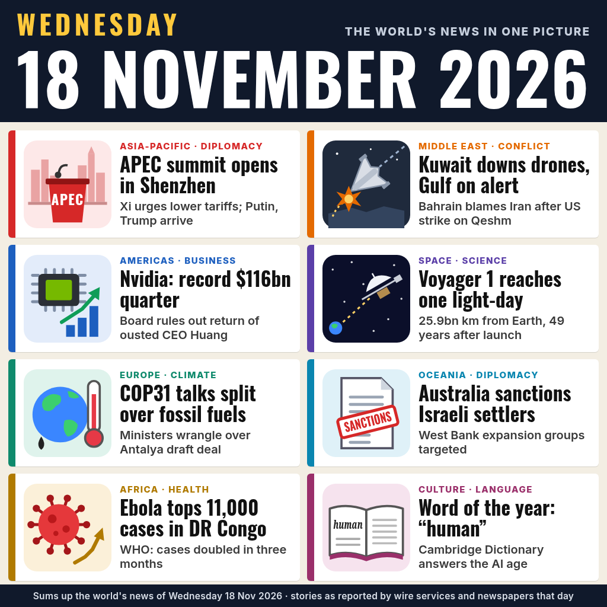

# The world on Wednesday 18 November 2026, in one picture

An entry for the make.fun bounty **Sum up 18 November's world news in one image**:
<https://make.fun/bounty/news-image-20261118>



`entry.png` (1024x1024 PNG) is a front page of eight stories from 18 November 2026. Each has a hand-drawn
pictogram, a short headline and one line of context. The stories span Asia-Pacific, the Middle East, the
Americas, Europe, Oceania, Africa and space, and cover diplomacy, conflict, business, science, climate, health
and culture:

| Region · field | Story |
| --- | --- |
| Asia-Pacific · diplomacy | APEC summit opens in Shenzhen: Xi urges lower tariffs; Putin, Trump arrive |
| Middle East · conflict | Kuwait downs drones, Gulf on alert: Bahrain blames Iran after US strike on Qeshm |
| Americas · business | Nvidia posts record ~$116bn quarter; board rules out ousted CEO Huang's return |
| Space · science | Voyager 1 reaches one light-day (25.9bn km) from Earth |
| Europe · climate | COP31 talks in Antalya split over fossil fuels |
| Oceania · diplomacy | Australia sanctions Israeli settlers and West Bank expansion groups |
| Africa · health | Ebola tops 11,000 cases in DR Congo; WHO says cases doubled in three months |
| Culture · language | Cambridge Dictionary names "human" its word of the year |

## Files

- `main.ts`: the entry program (Node 22, standard library only, no network). It checks `entry.png`
  (PNG signature, every chunk's CRC, IHDR size at most 1024x1024, IEND present, at most 1 MiB) and writes the
  same bytes to `$MAKEFUN_OUTPUT_DIR/entry.png` (default `/output/entry.png`). It fails loudly if any check fails.
- `entry.png`: the committed image.
- `stories.json`: **the stories**, the only file to edit when the day's news moves on. It holds the date
  header, the footer, and for each story its region, field, headline, one line of context, pictogram name
  and the outlets it was checked against.
- `render-entry.mjs`: the renderer. It turns `stories.json` into an HTML page with hand-drawn SVG pictograms
  (`apec`, `drone`, `chip`, `voyager`, `climate`, `sanction`, `virus`, `dictionary`) and screenshots it at
  1024x1024 with headless Chrome into `entry.png`.

## Run

```sh
mkdir -p out && MAKEFUN_OUTPUT_DIR=out node main.ts
```

## Regenerate the image

Requires Google Chrome or Chromium, plus the Oswald, Inter and Noto Serif fonts installed on the system.

```sh
node render-entry.mjs            # writes out/entry.html and entry.png
CHROME=chromium node render-entry.mjs
```

To refresh the stories, edit `stories.json` (keep headlines to about six words and one short line of context),
re-run the renderer, look at the PNG at full size and at 300 px wide, then run `main.ts` again.

## Licence

MIT, see `LICENSE`. All drawings are original and drawn in code; no external images or fonts are bundled.
